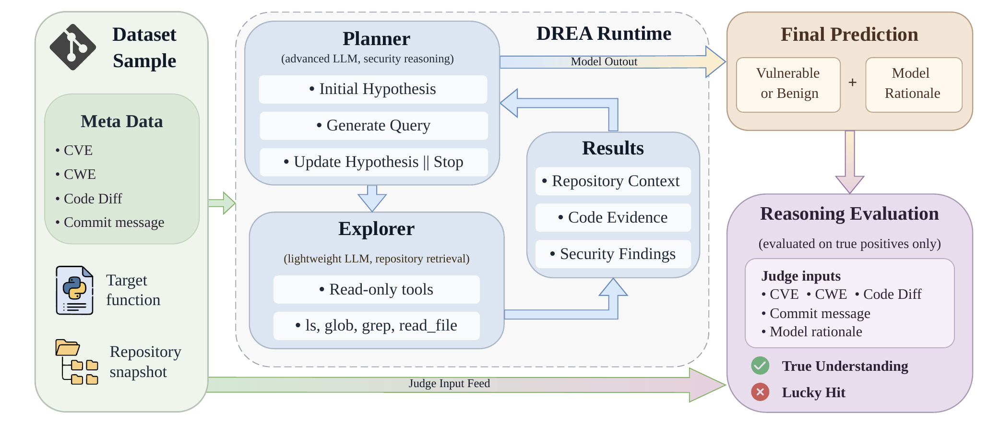
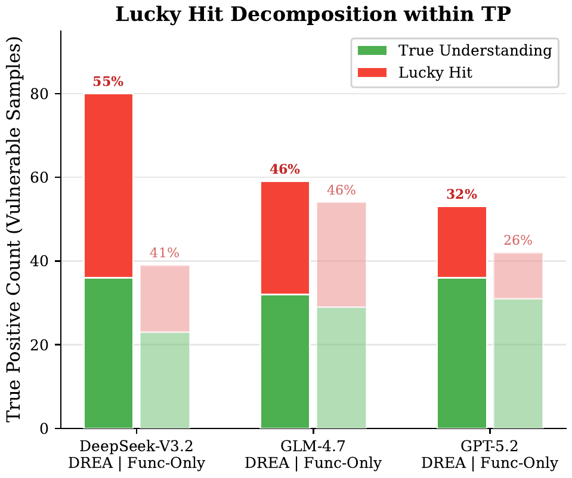

# DREA: Decoupled Reasoning and Exploration Agents for Repository-Level Vulnerability Detection

This repository contains the public artifact for **DREA: Decoupled Reasoning and
Exploration Agents for Repository-Level Vulnerability Detection**.

DREA separates two parts of repository-level vulnerability detection:

- a main reasoning agent that forms and revises security hypotheses;
- a read-only filesystem exploration agent that retrieves repository context
  without editing the target project.

## Introduction

Repository-level vulnerability detection requires more than classifying an
isolated function: the model often needs imports, call sites, configuration,
framework conventions, and patch context. DREA addresses this by decoupling
reasoning from repository exploration. The main agent keeps the vulnerability
analysis state, while a smaller explorer agent performs constrained read-only
filesystem inspection and returns compact evidence.



*Figure 1. DREA runtime overview: the planner forms hypotheses, the explorer
retrieves read-only repository context, and optional LLM-as-judge evaluation
distinguishes true understanding from lucky hits.*

This artifact is designed for paper reproduction and follow-up research. It
supports:

- running DREA on vulnerable or patched repository snapshots;
- running the function-only, whole-file, and single-agent baselines from the
  paper;
- reconstructing local repository snapshots from public upstream projects;
- computing direct tag-matching metrics and optional LLM-as-judge assessments.

## Contributions

This artifact supports the four contributions described in the paper:

- **DREA**: a hypothesis-driven framework that decouples a **Planner** (security
  reasoning and final verdict) from an **Explorer** (read-only repository
  navigation), enabling goal-directed context acquisition at tractable cost.
- **RepoPairBench**: a repository-grounded benchmark of 100 validated Python
  vulnerability-fix pairs (CVE-linked commits, CWE labels, vulnerable/patched
  function bodies, and reconstruction metadata).
- **Reasoning correctness evaluation**: an LLM-as-judge protocol that audits
  whether a model's rationale matches the documented vulnerability mechanism on
  true positives, diagnosing **Lucky Hits** (correct label, flawed reasoning).
- **Reproduction utilities**: scripts to reconstruct repositories, run DREA and
  baselines, and compute pair-level metrics plus reasoning-quality statistics.

## Repository Structure

```text
DREA-Artifact/
|-- code/                         # DREA, baselines, model registry, evaluators
|   |-- main.py                   # DREA entry point
|   |-- run_baseline.py           # Function-only baseline
|   |-- run_wholefile_baseline.py # Whole-file baseline
|   |-- run_single_agent.py       # Single-agent exploration baseline
|   |-- config/models.json        # Optional model registry
|   |-- core/prompts/             # Prompts
|   `-- process/eval/             # Metric and LLM-as-judge utilities
|-- data/
|   |-- repopairbench_100.jsonl
|   |-- repopairbench_100_manifest.json
|   `-- scripts/                  # Dataset reconstruction scripts
|-- docs/                         # Reproduction and configuration notes
|-- figures/                      # Static paper figures
|-- .env.example                  # Environment variable template
|-- CITATION.cff
`-- LICENSE
```

## Environment Setup

The code uses Python 3.13+ and `uv`.

```bash
cd code
uv sync
cp ../.env.example .env
```

Edit `code/.env` with your model endpoints and API keys. DREA can use either
the legacy `MAIN_*` environment variables or named entries from
`code/config/models.json`.

For a minimal OpenAI-compatible setup:

```bash
MAIN_BASE_URL=https://api.openai.com/v1
MAIN_API_KEY=replace-with-your-key
MAIN_MODEL=gpt-4o

VLLM_BASE_URL=http://localhost:8000/v1
VLLM_API_KEY=EMPTY
VLLM_MODEL=replace-with-your-explorer-model
```

See [docs/model_config.md](docs/model_config.md) for Anthropic, Gemini, and
custom OpenAI-compatible model registry configuration.

## Dataset

RepoPairBench 100 is provided in:

- [data/repopairbench_100.jsonl](data/repopairbench_100.jsonl)
- [data/repopairbench_100_manifest.json](data/repopairbench_100_manifest.json)

Each JSONL item contains:

- sample id and upstream project name;
- public repository URL and fixing commit hash;
- language, CVE ids, and CWE ids;
- target file path;
- vulnerable function body and patched function body.

Full upstream repositories are not vendored. Reconstruct them locally from the
public repositories:

```bash
cd code

bash ../data/scripts/clone_repos.sh \
  --manifest ../data/repopairbench_100_manifest.json \
  --output ../repos

uv run python ../data/scripts/build_paired_dataset.py \
  --jsonl ../data/repopairbench_100.jsonl \
  --repos ../repos \
  --output ../dataset
```

See [data/DATASET.md](data/DATASET.md) for the dataset schema and usage notes.

## Running DREA

After reconstructing `../dataset`, run DREA on the vulnerable version:

```bash
cd code

uv run main.py <project_name> \
  --dataset-dir ../dataset \
  --type vul \
  --model <model_id>
```

Run the patched counterpart with:

```bash
uv run main.py <project_name> \
  --dataset-dir ../dataset \
  --type sec \
  --model <model_id>
```

If `--model` is omitted, the main agent uses `MAIN_BASE_URL`, `MAIN_API_KEY`,
and `MAIN_MODEL` from `.env`. Named model ids are defined in
[code/config/models.json](code/config/models.json).

## Baselines

The artifact includes the paper baselines.

Function-only baseline:

```bash
cd code

uv run run_baseline.py <item_id> \
  --dataset-path ../data/repopairbench_100.jsonl \
  --type vul \
  --model <model_id>
```

Whole-file baseline:

```bash
uv run run_wholefile_baseline.py <item_id> \
  --dataset-path ../data/repopairbench_100.jsonl \
  --repo-cache-dir ../repos \
  --type vul \
  --model <model_id>
```

Single-agent exploration baseline:

```bash
uv run run_single_agent.py <item_id> \
  --dataset-path ../data/repopairbench_100.jsonl \
  --repo-cache-dir ../repos \
  --type vul \
  --model <model_id>
```

Use `--type sec` for the patched-code counterpart. Generated logs are local
runtime outputs and are not included in this artifact.

## Evaluation

The paper evaluates detection along two complementary dimensions, both supported
by this artifact.

**Binary detection** checks whether the final verdict matches the ground truth
(e.g., recall, false-positive rate, and **Pair-Correctness**, which requires
both the vulnerable and patched members of a pair to be classified correctly).

**Reasoning correctness** goes further: on vulnerable
samples where the model already predicts `VULNERABLE` (true positives), an
LLM-as-judge reads the planner's final rationale together with the CVE
description, fix commit message, code diff, and CWE labels, then decides whether
the explanation aligns with the documented vulnerability mechanism. The judge
outputs `Accurate` or `Inaccurate`; the latter are **Lucky Hits**—predictions
with the right label but reasoning that does not match the documented flaw.

### What Lucky Hits imply

A main empirical finding is that **26–55% of true positives are Lucky Hits** for
both DREA and the function-only baseline across the evaluated backbones. In
other words, many apparent detection successes under binary metrics are not
backed by sound vulnerability reasoning. This identifies **security reasoning
quality as a shared bottleneck for current LLMs**, not a limitation of
function-only analysis alone: providing more repository context improves
Pair-Correctness and can increase the absolute number of correctly-reasoned
detections, but a large fraction of correct labels still rest on flawed
rationales. Decomposing true positives into accurate reasoning vs. lucky hits
therefore complements tag-level and pair-level metrics when assessing
LLM-based detectors.



*Figure 2. Decomposition of true positives into accurate reasoning vs. Lucky Hits
(correct `VULNERABLE` label, flawed rationale) for DREA and the function-only
baseline. Bar labels show Lucky Hit Rate (LHR); Reasoning Accuracy (RA) is
1 − LHR.*

### Direct verdict matching

```bash
cd code

uv run python -m process.eval.match \
  --logs-dir logs \
  --output-dir ../results
```

### Reasoning quality (LLM-as-judge)

```bash
uv run python -m process.eval.assess_logs \
  --logs-root logs \
  --model <judge_model_id> \
  --dataset-dir ../dataset

uv run python -m process.eval.llm-judge \
  --logs-dir logs \
  --output-dir ../results
```

## Citation

```bibtex
@inproceedings{sun2026drea,
  author    = {Sun, Mingyang and Meng, Guozhu},
  title     = {DREA: Decoupled Reasoning and Exploration Agents for Repository-Level Vulnerability Detection},
  booktitle = {Proceedings of the 17th International Conference on Internetware},
  series    = {Internetware '26},
  year      = {2026},
  date      = {2026-07-18/2026-07-20},
  location  = {Gold Coast, Australia},
  publisher = {Association for Computing Machinery},
  address   = {New York, NY, USA},
  note      = {To appear}
}
```
